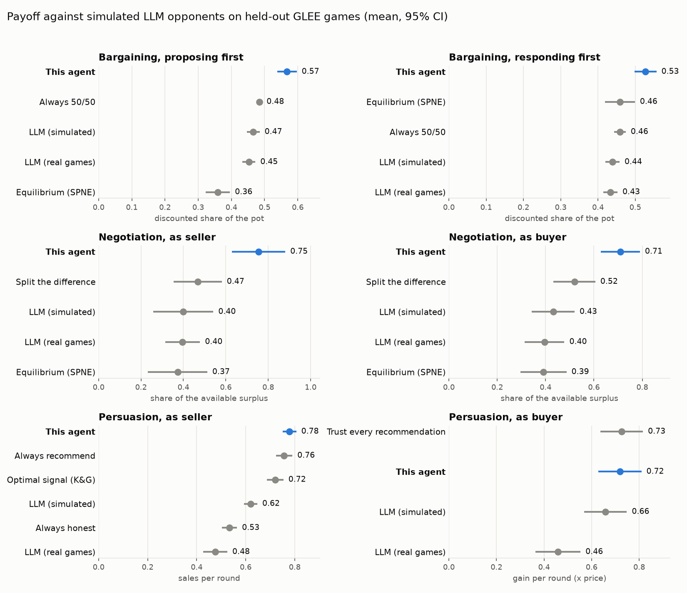

# GLEE negotiation agent

[](https://github.com/sh4dmi/glee-agent/actions/workflows/ci.yml)

An agent for the three economic games of [GLEE](https://github.com/eilamshapira/GLEE) (bargaining,
negotiation and persuasion) that best-responds to how LLMs actually play, learned from 77,000
LLM-vs-LLM games.

Game theory says what a perfectly rational player should do. GLEE's opponents are LLMs, which aren't
perfectly rational: they anchor on 50/50 splits, accept offers a rational player would refuse, and
react to the last offer on the table. This agent fits models of that behaviour on GLEE's own game logs,
then plans against them with dynamic programming. An LLM is used only for wording, never for decisions.



## Results

The test set is 200 game configurations from the 20% of GLEE games held out from training. The agent
plays both seats against simulated LLM opponents, which are sampled from models re-fitted on the held-out
games only. The **paired difference** compares the agent with each alternative on the same
configurations and the same random seeds, so it is tighter than the overlap of the confidence intervals
in the chart suggests.

| Game, seat | This agent | LLM (simulated) | Best simple rule | Agent − LLM (paired, 95% CI) |
|---|---|---|---|---|
| Bargaining, proposing first (discounted share of the pot) | **0.57** | 0.47 | 0.48 (always 50/50) | +0.10 ± 0.03 |
| Bargaining, responding first | **0.53** | 0.44 | 0.46 (always 50/50) | +0.09 ± 0.03 |
| Negotiation, seller (share of available surplus) | **0.75** | 0.40 | 0.47 (split the difference) | +0.35 ± 0.12 |
| Negotiation, buyer | **0.71** | 0.43 | 0.52 (split the difference) | +0.28 ± 0.08 |
| Persuasion, seller (sales per round) | **0.78** | 0.62 | 0.76 (always recommend) | +0.16 ± 0.02 |
| Persuasion, buyer (gain per round, × price) | 0.72 | 0.66 | **0.73** (trust every recommendation) | +0.06 ± 0.02 |

What the numbers say:

* **Bargaining and negotiation** show the largest gains. The exact equilibrium (SPNE) does *worse*
  than an average LLM in three of the four seats: playing optimally against a rational opponent is the
  wrong goal when the opponent isn't one. In negotiation the agent never accepts or proposes a price
  worse than its outside option, while the simulated LLMs sometimes do.
* **Persuasion, seller**: the agent sells more than Kamenica & Gentzkow's optimal signal (+0.06 ± 0.02),
  because LLM buyers trust recommendations more than a Bayesian would. Its edge over "always recommend"
  is small (+0.02 ± 0.01).
* **Persuasion, buyer**: against the simulated LLM sellers, who are fairly honest, the Bayesian buyer
  ties with blindly following recommendations (−0.007 ± 0.003). Against a seller who recommends
  everything, it earns 0.38 per round versus 0.26 for the trusting buyer: its scepticism costs
  little when sellers are honest and pays when they aren't.
* **Simulator fidelity**: when the simulated LLM takes the agent's seat, it earns about what real LLMs
  earned in the same held-out games for bargaining (0.47 vs 0.45; 0.44 vs 0.43) and negotiation (0.40
  and 0.43 vs 0.40). Persuasion fits worse (0.62 vs 0.48 for sellers), because the buying model is trained on
  yes/no recommendations and doesn't read free-text messages.

These results come from a simulation. The simulated opponent is independent of the agent's own models,
but it shares their structure: it reacts to the last offer, not to the whole conversation. So read the
gains as an estimate of what to expect against LLMs like those in GLEE's data, not as a guarantee.

## How it works

```
GLEE ──POST /chat──► parse ─► interpret ─► decide ─► compose ─► validate ──► JSON answer
                     protocol   (LLM, opt.)  policies   (LLM, opt.)  GLEE's format rules
```

1. **Data.** `scripts/build_dataset.py` turns GLEE's logs into one row per offer: 90k bargaining
   offers, 94k negotiation offers and 260k persuasion rounds, from 13 LLMs.
2. **Opponent models.** Gradient-boosted classifiers predict whether an LLM accepts an offer. A
   monotone constraint guarantees that more money for the responder never lowers the predicted
   acceptance. Smoothed conditional histograms predict what LLMs offer. On held-out games the
   classifiers reach AUC 0.79 (bargaining), 0.80–0.96 (negotiation) and 0.97 (persuasion), and beat
   a logistic-regression baseline in every case ([`results/model_metrics.json`](results/model_metrics.json)).
3. **Planning.** Dynamic programming over the remaining rounds, with the last offer on the table as
   state. The agent keeps Bayesian beliefs over parameters the opponent keeps hidden, only considers
   offers that LLMs actually make (so it doesn't exploit errors in the model), and never takes back a
   concession. As a seller in persuasion, it plans over the sales record the buyer can see. As a buyer,
   it treats a myopic seat as a one-armed bandit.
4. **Language (optional).** With `LLM_API_KEY` set, an LLM rewords the message attached to each offer
   (a rewrite that changes any number is discarded) and reads free-text seller messages. Without it the
   agent runs fully offline.

The maths, design choices and limitations are in [`docs/DESIGN.md`](docs/DESIGN.md).

## Quick start

```bash
pip install -e .            # Python 3.11+
cp .env.example .env        # optional: GLEE_KEY, LLM_API_KEY
glee-agent --port 5001      # or: python -m glee_agent.server --port 5001
```

To play it in GLEE, put the same key in GLEE's `http_keys.json` and point a config at the server:

```json
{"player_1_type": "terminal", "player_2_type": "http",
 "player_1_args": {"public_name": "Alice"},
 "player_2_args": {"public_name": "Bob", "player_id": 3, "url": "http://127.0.0.1:5001"},
 "game_type": "bargaining",
 "game_args": {"money_to_divide": 10000, "max_rounds": 12, "complete_information": false,
               "messages_allowed": true, "delta_1": 0.9, "delta_2": 0.95}}
```

```bash
python main.py -c my_config.json     # from the GLEE repository
```

## Reproduce

```bash
pip install -e ".[dev]"
git clone https://github.com/eilamshapira/GLEE.git ../GLEE      # ~2 GB of game logs
python scripts/build_dataset.py --glee ../GLEE                  # -> data/*.parquet       (~7 min)
python scripts/train_models.py                                  # -> models/, results/model_metrics.json
python scripts/evaluate.py --games 200                          # -> results/evaluation*  (~6 min)
python scripts/plot_results.py                                  # -> results/evaluation.png
pytest                                                          # 34 tests
```

The trained models are included, so the server runs without the dataset. The train/test split is a
deterministic hash of the game ID.

## Repository layout

```
src/glee_agent/
  server.py          Flask app: /chat, /health, X-API-Key auth
  graph.py           the LangGraph pipeline (parse, interpret, decide, compose, validate)
  protocol.py        rebuilds the game state from GLEE's conversation, from game_params or the rules text
  policies/          bargaining.py, negotiation.py, persuasion.py: the decision logic
  theory.py          exact SPNE, negotiation equilibrium, Bayesian-persuasion formulas
  features.py        model features, shared by training and play
  opponent.py        model container, back-off histograms
  llm.py             optional wording and message interpretation
  validate.py        GLEE's format rules, and a safe fallback answer
scripts/             dataset, training, evaluation, plotting; simulator.py re-implements GLEE's game loop
tests/               theory, protocol parsing, policy guarantees, server, full simulated games
models/              trained opponent models
results/             metrics, per-game evaluation results, chart
docs/DESIGN.md       how and why
```

## Background

This started as a two-person entry to the GLEE AI Agents hackathon at the Technion's Faculty of Data
and Decision Sciences (December 2025), where it placed 3rd of about 80 teams. That version was an LLM
deciding with heuristic hints. This repository is a rewrite from scratch: the decisions now come
from models of LLM behaviour and explicit planning, with tests and a held-out evaluation.

## Credits

The games, prompts and the LLM-vs-LLM dataset are from GLEE:

> Shapira, Madmon, Reinman, Amoyal, Reichart and Tennenholtz (2024).
> *GLEE: A Unified Framework and Benchmark for Language-based Economic Environments.*
> [arXiv:2410.05254](https://arxiv.org/abs/2410.05254)

The data is not redistributed here; `scripts/build_dataset.py` reads it from a clone of the GLEE
repository.

MIT License.
